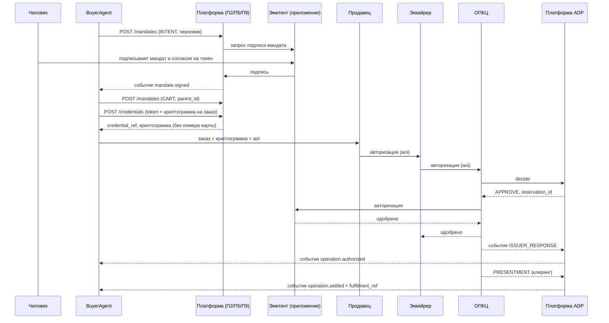
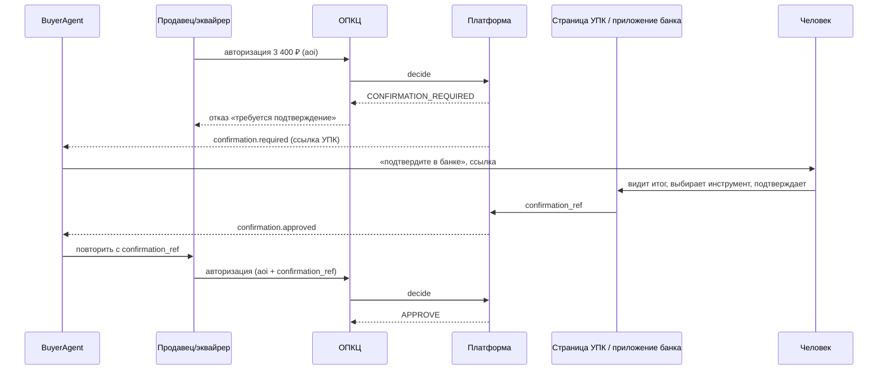
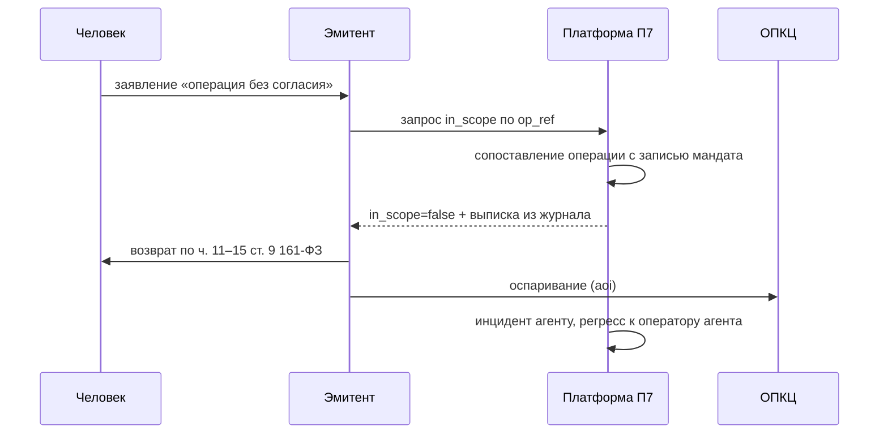

# Интерфейс Платформы с процессингом и системами оператора

Редакция 1 · 08.10.2026. Машиночитаемая часть: `processing-interface.yaml`.

## 0. Как читать

Конкретные номера полей, теги и коды ответов форматов ОПКЦ, СБП и токен-сервиса Платформе не известны: это внутренние альбомы оператора. Поэтому:
- Платформа работает с **канонической моделью сообщения** (раздел 2);
- для каждого внешнего формата пишется **адаптер** с таблицей соответствия. Места, где нужен номер поля или кода из альбома, помечены `[альбом]`;
- в песочнице адаптеры работают с эмуляторами, использующими каноническую модель напрямую (РП6).

## 1. Интерфейсы

| Код | Интерфейс | Направление | Тип | Назначение |
|---|---|---|---|---|
| ПИ-1 | Точка решения ADP | ОПКЦ → Платформа | синхронный запрос-ответ | Решение по агентской операции и резерв бюджета в пути авторизации |
| ПИ-2 | Признак в сообщениях процессинга | эквайрер → ОПКЦ → эмитент | расширение формата | Перенос `aoi` во всех сообщениях операции до спора |
| ПИ-3 | События операции | ОПКЦ → Платформа | асинхронный поток | Ответ эмитента, реверсал, клиринговое представление, возврат, оспаривание |
| ПИ-4 | Токен-сервис | Платформа ↔ токен-сервис | синхронный | Выпуск агентского токена, домен, криптограммы, приостановка |
| ПИ-5 | СБП | Платформа ↔ операционный центр СБП | синхронный + события | Агентские списания по привязке счёта, признак, возвраты |
| ПИ-6 | Универсальный платёжный код | Платформа ↔ оператор УПК | синхронный + редирект | Страница подтверждения и выбора инструмента |
| ПИ-7 | Антифрод | Платформа → антифрод; антифрод → Платформа | поток признаков + обратная связь | Признак, класс и уровень агента как входы модели; причины отказов |
| ПИ-8 | Участники | эмитенты и эквайреры ↔ Платформа | REST | Лимиты клиента, уведомления, отзыв, подпись мандата в приложении, знак готовности |
| ПИ-9 | Отчётность | Платформа → хранилище сведений об операциях | пакетный | Признак в сведениях по 115-ФЗ, выгрузки для надзора |

## 2. Каноническая модель агентской операции

```json
{
  "op_ref": "OPKC-20261008-000123",
  "msg_type": "AUTH_REQUEST",
  "channel": "CARD",
  "amount": 189000,
  "currency": "RUB",
  "merchant": { "id": "MER-1042", "mcc": "5462", "acquirer_id": "ACQ-01", "name": "Масса Мадре" },
  "instrument": { "kind": "AGENT_TOKEN", "token_ref": "tok_ag_7f2c", "cryptogram": "base64...", "issuer_id": "ISS-01" },
  "aoi": { "indicator": true, "agent_code": "nspk:agent:buyref-01:v3", "mandate_id": "MND-8f31c0", "fulfilment_ref": null },
  "confirmation_ref": null,
  "order_ref": "ORD-77a1",
  "ts": "2026-10-08T08:41:12Z"
}
```

`instrument.kind`: `AGENT_TOKEN` (карта «Мир» через агентский токен), `ACCOUNT_LINK` (привязка счёта СБП), `CARD_TOKEN` (обычный токен — тогда операция агентская только при наличии `aoi`; такая операция отклоняется `CREDENTIAL_INVALID` на проверке 2: агентский реквизит — только `AGENT_TOKEN` Платформы, РП48 (а)).

Номер карты в каноническую модель не попадает никогда. Адаптер ОПКЦ передаёт в Платформу только ссылку на токен.

## 3. ПИ-1. Точка решения ADP

**Вызов:** `POST /adp/v1/decide`, тело — каноническая модель с `msg_type = AUTH_REQUEST`.

**Ответ:**

```json
{
  "decision": "APPROVE",
  "reason": null,
  "reservation_id": "RSV-55e1",
  "agent_level": 1,
  "mandate_left_after": 311000,
  "decided_in_ms": 7
}
```

`decision`: `APPROVE` · `DECLINE` · `CONFIRMATION_REQUIRED` · `BYPASS` (операция не агентская; процессинг продолжает без изменений).
`reason` — код из раздела 6.
Пары в ответе ADP (РП19): `APPROVE`, `BYPASS` — `reason: null`; `DECLINE` — код раздела 6, кроме `CONFIRMATION_REQUIRED` и `ADP_UNAVAILABLE`; `CONFIRMATION_REQUIRED` — `reason: CONFIRMATION_REQUIRED`. `ADP_UNAVAILABLE` ADP не возвращает: это решение процессинга при таймауте (`DECLINE` / `ADP_UNAVAILABLE`). Несогласованная пара — отказ, как неизвестный код (A3 п. 4.5).

**Требования:**
- p99 ≤ `adp_p99_ms`; процессинг ждёт не дольше `adp_timeout_ms`, затем отклоняет **агентскую** операцию кодом `ADP_UNAVAILABLE`;
- идемпотентность по `op_ref`: повтор возвращает прежнее решение, второй резерв не создаётся. Запись операции «в работе» создаётся атомарно до резерва (на PostgreSQL — условная вставка): одновременный повтор на другом экземпляре — `DECLINE` / `STATE_UNAVAILABLE`; повтор с другим сообщением (хэш канонического JSON без `ts` и `seq`) — `STATE_UNAVAILABLE` и инцидент (РП43 доп. п. 16–17);
- `BYPASS` определяется по отсутствию признака **и** неагентскому инструменту (`CARD_TOKEN`); признак отсутствует, если `aoi` нет, `aoi: null` или `aoi.indicator: false` без `agent_code` и `mandate_id` (нет или `null`) — эквайрер может передавать поле признака во всех сообщениях (РП49 (в)). `indicator: false` с кодом агента или мандатом — противоречивый признак: `CREDENTIAL_INVALID` и инцидент со счётчиком по паре «эквайрер + продавец» (РП48 (а)); `aoi` без `indicator` — `AOI_MISSING`. Это первая проверка, стоимость ≤ `bypass_overhead_ms`: до любого чтения хранилищ, записи операции и идемпотентности по `op_ref`, независимо от самопроверки (РП43 п. 1). Неизвестный `instrument.kind` без `aoi` — `DECLINE` / `AOI_MISSING` и инцидент, не `BYPASS`;
- любой ответ ADP, кроме 200 с согласованной парой (РП19), — отсутствие решения: процессинг ставит `DECLINE` / `ADP_UNAVAILABLE` агентской операции. Так же — некорректное агентское сообщение (400) и режим «только `BYPASS`» при непрошедшей самопроверке (503, РП43 п. 8). Тело 400 и 503 — `{}`, кодов нет. Запрос — только `Content-Type: application/json`; другой тип или тело не JSON — 400 `{}` (вид инструмента не прочитать — и неагентской тоже, доп. РП43 п. 23);
- до аутентификации процессинга (mTLS ОПКЦ, SEC-1) маршрут доступен только на стенде (`createStand`, 127.0.0.1) и в тестах; рабочий процесс (`main.ts`) его не открывает (доп. РП43 п. 21, SECURITY.md А7);
- агентский инструмент (`AGENT_TOKEN`, `ACCOUNT_LINK`) без `aoi` — операция агентская, `BYPASS` для неё невозможен: так приходит авторизация от эквайрера, который не переносит `aoi` (РП22 п. 6). При `aoi_rollout_phase` 1–2 ADP определяет агента и мандат по домену токена (ФП4, с PS-14), а не по `aoi`; при 3 (песочница, A1 п. 8.3) — `AOI_MISSING` (РП43 п. 2). Метаданные пакета, переданные продавцом в API для продавцов (`credential_ref`, `order_ref`, `aoi`), служат только сверке и отчётности: решение ADP от них не зависит. `CARD_TOKEN` без `aoi` — неагентская операция (инвариант 2), как и с `aoi.indicator: false` без `agent_code` и `mandate_id` (РП49 (в)); `CARD_TOKEN` с иным `aoi` — `CREDENTIAL_INVALID` и инцидент со счётчиком по эквайреру и продавцу (РП48 (а)): ошибочный признак эквайрера отклоняет обычную покупку человека — источник виден по счётчику;
- при `APPROVE` резерв создаётся атомарно в том же вызове: `op_key` = `op_ref`, `reservation_id` = `hold.id`; после резерва — сверка статуса мандата (РП43 п. 5). По CART — два резерва (CART, затем родитель INTENT), `reservation_id` — удержание CART, `mandate_left_after` — меньшее из остатков CART и родителя (РП43 п. 6);
- состояние журнала, реестра или П3 не подтверждено — `DECLINE` / `STATE_UNAVAILABLE`, не `BYPASS` (РП43 п. 4);
- `split_detected` (РП44 п. 7): `true` — только у `CONFIRMATION_REQUIRED` по дроблению (SPEC §6 п. 9: операция не выше порога, но вместе с одобренными в окне `split_window_sec` по корневому INTENT их не меньше `split_min_ops` и сумма выше порога); `false` — у `CONFIRMATION_REQUIRED` по порогу одной операции (п. 10) и у `CONFIRMATION_REQUIRED` после проигранного погашения `confirmation_ref` (операция по окну не оценивалась, Дополнения РП50 п. 2); у прочих решений поля нет. Повтор `op_ref` отдаёт тот же `split_detected`.
- **повтор с `confirmation_ref`** (РП50, Дополнения п. 7) — новая авторизация с **новым** `op_ref`: тот же `op_ref` с добавленной ссылкой — другое сообщение (хэш), `DECLINE` / `STATE_UNAVAILABLE` и инцидент «повтор `op_ref` с другим сообщением» (РП43 п. 5). Ссылка без `order_ref` в сообщении не учитывается.

**Режим «сам эмитент».** ADP выполняет проверки 1–6 раздела 6 SPEC и возвращает `APPROVE` без резерва. Эмитент вызывает `POST /participants/v1/state/reserve` (ПИ-8) сам.

## 4. ПИ-2. Признак в сообщениях процессинга

| Элемент признака | Каноническое поле | Формат | Место в сообщении ОПКЦ |
|---|---|---|---|
| Указание на агентский характер | `aoi.indicator` | 1 символ, `A` | `[альбом]` поле частного использования, субполе 1 |
| Код агента | `aoi.agent_code` | до 64 символов, `ns:id:ver` | `[альбом]` субполе 2 |
| Идентификатор мандата | `aoi.mandate_id` | до 32 символов | `[альбом]` субполе 3 |
| Ссылка на запись об исполнении | `aoi.fulfilment_ref` | до 32 символов, необязательно | `[альбом]` субполе 4 |
| Ссылка подтверждения | `confirmation_ref` | до 32 символов | `[альбом]` субполе 5 |

Правила (A1):
- признак формирует сторона, принявшая обращение агента, — продавец или эквайрер (A1 п. 4.1);
- эмитент вправе сформировать признак сам при выявлении агентского характера (п. 4.2);
- после формирования признак не изменяется (п. 4.3) и передаётся во всех сообщениях операции: авторизация, реверсал, представление, возврат, оспаривание (п. 5.1);
- указание без кода агента делает сообщение некорректным (п. 3.2).

Очереди внедрения (A1 п. 8.3): 1 — приём и передача; 2 — обязательное проставление; 3 — ответственность и обязательный отказ при неопознанном коде. В песочнице включены все три; для пилота очередь задаётся параметром `aoi_rollout_phase`.

## 5. ПИ-3. События операции

Поток от ОПКЦ к Платформе. Каждое событие несёт `op_ref`, `reservation_id` (если был), `aoi`.

| Событие | Действие Платформы |
|---|---|
| `ISSUER_RESPONSE` (одобрено / отказ) | Отказ эмитента → освобождение резерва |
| `REVERSAL` | Освобождение резерва |
| `PRESENTMENT` (полное или частичное) | Закрепление; запись об исполнении; событие агенту |
| `REFUND` | Возврат; бюджет — по `restore_budget_on_refund` |
| `CHARGEBACK` | Связь со спором П7; доказательства из журнала |
| `AUTH_EXPIRED` | Освобождение по `reservation_ttl` |

Доставка «не менее одного раза», обработка идемпотентна по `(op_ref, event_type, seq)`. События, пришедшие не по порядку (представление раньше ответа эмитента), ставятся в очередь до `event_reorder_window_ms`.

## 6. Коды решений и их соответствие кодам ответа

Агентские отказы отделены от отказов по лимиту и по фроду (A1 п. 5.3). Номера кодов ответа ОПКЦ назначает оператор — `[альбом]`.

| Код Платформы | Смысл | Код ответа ОПКЦ | Что видит агент (событие ПАО) |
|---|---|---|---|
| AOI_MISSING | Нет признака или кода | `[альбом]` «некорректное агентское сообщение» | `operation.declined` |
| AOI_MISMATCH | Код в признаке ≠ домену токена | `[альбом]` | `operation.declined` + инцидент |
| AGENT_UNKNOWN | Агента нет в реестре | `[альбом]` «агент не опознан» | `operation.declined` |
| AGENT_SUSPENDED | Допуск приостановлен | `[альбом]` | `agent.suspended` |
| CREDENTIAL_INVALID | Криптограмма неверна, истекла, использована или не для этого продавца; токена нет в хранилище Платформы (РП47 п. 6–8) | `[альбом]` | `operation.declined` |
| MANDATE_NOT_FOUND / EXPIRED / REVOKED | Мандат | `[альбом]` «нет полномочий агента» | `mandate.*` |
| MANDATE_SCOPE | Продавец или категория вне мандата | `[альбом]` «нет полномочий агента» | `operation.declined` |
| LIMIT_EXCEEDED | Превышено ограничение | `[альбом]` «превышение полномочий агента» | `operation.declined` |
| STATE_UNAVAILABLE | Состояние не подтверждено | `[альбом]` «превышение полномочий агента» | `operation.declined` |
| CONFIRMATION_REQUIRED | Нужно подтверждение | `[альбом]` «требуется подтверждение клиента» (аналог мягкого отказа) | `confirmation.required` |
| ADP_UNAVAILABLE | Таймаут ADP; код ставит процессинг (РП19) | `[альбом]` «агентская проверка недоступна» | `operation.declined` |

Коды П3 сопоставляются причинам этой таблицы на границе ADP — РП43 п. 3 (`PRINCIPAL_SIGNATURE_PENDING` → `MANDATE_NOT_FOUND`; `IDEMPOTENCY_CONFLICT`, `RESERVATION_RELEASED` → `STATE_UNAVAILABLE`; `REQUEST_INVALID` — ответ 400, у процессинга `ADP_UNAVAILABLE`).

Продавец получает от эквайрера отказ с этим кодом. Агент узнаёт о результате событием ПАО от Платформы, а не от продавца — так агенту не нужно доверять пересказу продавца.

## 7. ПИ-4. Токен-сервис

| Операция | Вход | Выход |
|---|---|---|
| Выпуск агентского токена | `funding_ref` (ссылка эмитента на карту клиента), `agent_code`, `mandate_id`, `merchant_scope`, `valid_to`, `merchant_mcc` (наборы MCC продавцов области — РП49 (д)) | `token_ref`, домен |
| Криптограмма на заказ | `token_ref`, `order_ref`, `amount_max`, `currency`, `merchant_id`, `valid_to` | одноразовая криптограмма (HMAC-SHA-256 ключа токен-сервиса над `canonicalJson` входа), срок `cryptogram_ttl_sec`, не позже срока CART |
| Проверка криптограммы | те же поля и криптограмма | верна / не верна |
| Приостановка или удаление | `token_ref` или все токены `agent_code` | статус |

Выпуск токена требует согласия клиента в приложении эмитента — подпись мандата и согласие на токен объединяются в одно действие клиента. Номер карты Платформа и агент не получают никогда.

**Домен и криптограмма (РП47):** один токен на мандат CART — домен `{agent_code, mandate_id CART, merchant_scope CART, valid_to CART, merchant_mcc}`, где `merchant_mcc` — набор допустимых MCC на каждого продавца области из справочника продавцов оператора (РП49 (д); на стенде — MCC витрины эмулятора, в бою — справочник эквайреров, форма `[альбом]`, РП6; MCC — ровно четыре цифры); продавца нет в справочнике или набор пуст — токен не выпускается, `funding_ref` — от банка клиента мандата (на стенде — эмулятор эмитента); без `token_consent` в записи `MANDATE_SIGNED` корня токен не выпускается. `valid_to` криптограммы = min(сейчас + `cryptogram_ttl_sec`, срок CART), при повторе того же заказа — из записи реквизита: криптограмма пересчитывается та же. Платформа хранит SHA-256 криптограммы, а не значение; однократность — условной записью Платформы при одобрении (SPEC §6 п. 4, 11). Ключ эмулятора — только в памяти стенда; в бою ключ у токен-сервиса или банка (SEC-1). Форматы сети — `[альбом]` (РП6).

## 8. ПИ-5. СБП

- **Агентский инструмент** — привязка счёта клиента с ограничениями Платформы. Списание по привязке идёт по инициативе получателя: продавец через своего банка-участника.
- **Признак** передаётся в поле дополнительной информации сообщения C2B `[альбом]`; при отсутствии поля в стандарте на пилоте используется справочник «привязка → агент → мандат» в Платформе, а ADP вызывается операционным центром СБП по идентификатору привязки.
- **Возвраты** — штатный возврат СБП; событие `REFUND` в Платформу.
- **Удержания в СБП нет**: система переводит, а не хранит. Условное исполнение — вне Платформы.

## 9. ПИ-6. Универсальный платёжный код

Поверхность подтверждения, которая не принадлежит ни продавцу, ни агенту (F26):
1. На `CONFIRMATION_REQUIRED` Платформа создаёт запрос подтверждения с итоговыми значениями из сообщения процессинга: агент, мандат, продавец, сумма с валютой, `order_ref`; срок — `order_hold_sec` (РП50 п. 1–3). Без `order_ref` запрос не создаётся; после `EXPIRED`, `REJECTED`, `USED` на тот же заказ — тоже (A7 п. 7.3, РП50 п. 9).
2. Человек получает ссылку или код УПК, открывает платёжную страницу, видит итог, **сам выбирает инструмент** и подтверждает. Ссылка — `link` в `GET /pao/v1/confirmations/{id}` агента (РП51 п. 10). Страница УПК — PS-19 ч. 3 (РП51 п. 12–16): решение одноразовым кодом от эмитента; выбор СБП — при стендовом `upk_sbp_enabled` (до PS-21 — `false`); решение страницы присылает оператор УПК — участник ПИ-8 с ролью `UPK` и `instrument_chosen`, ссылка действует только по выбранному каналу (`channel` сообщения); боевой оператор УПК — после привязки его решения к аутентификации у эмитента. До ч. 3 решение человека — в приложении эмитента.
3. Решение человека приходит Платформе подписанной записью участника (ПИ-8 `POST /participants/v1/confirmations/{id}`, РП50 п. 4–5) с `totals_hash` итоговых значений; при `APPROVE` Платформа выдаёт `confirmation_ref` (128 бит случайности, не id запроса). Ссылка однократная, срок — `order_hold_sec`.
4. Продавец повторяет авторизацию с `confirmation_ref`; ADP проверяет совпадение итоговых значений и гасит ссылку после резерва (РП50 п. 7–10). Недействующая ссылка не учитывается — выше порога снова `CONFIRMATION_REQUIRED`.

Альтернатива — push в приложение эмитента (ПИ-8). Выбор канала — по настройке эмитента и клиента.

## 10. ПИ-7. Антифрод

- **В модель:** `aoi.indicator`, класс и уровень агента, возраст мандата, доля использования бюджета, признак дробления, история инцидентов агента.
- **Из модели:** причина отказа по фроду в обобщённой категории — для расчёта доли ложных отказов агентских операций (К14). Логика модели Платформе не раскрывается.
- **Метрика с первого дня:** доля отказов агентских операций по фроду против неагентских того же продавца.

## 11. ПИ-8. Участники

**Эмитент:**
- `PUT/GET /participants/v1/principals/{ref}/limits` — лимиты клиента (РП45 п. 1, 3): подписанная запись банка `{context, participant_code, kid, principal_ref, version, limits, issued_at}` с меткой `pao:participant-limits:v1`; только вставка, действует наибольшая `version`; та же версия с другой записью или версия ниже действующей — 409 `LIMITS_VERSION_CONFLICT`; неизвестное поле или `period` — 422 `LIMITS_UNSUPPORTED`. Одновременные версии на двух экземплярах могут записаться обе (банку по младшей — 200), действует наибольшая (РП45 доп. п. 10). Снятие `per_period` или смена `period` — расширение, со следующего периода (доп. п. 7). `Limits.currency` (ISO 4217) обязательна при любом поле суммы, `period` — `DAY` или `MONTH` (календарный, `client_limit_period_tz`). Расширение — только с подтверждением клиента (в банке; запись банк присылает после подтверждения), сужение и расширение суммы — сразу с новой версии (РП46 (г)); сужение ниже израсходованного в периоде прошлое не отменяет — остаток 0 до конца периода. `GET` — действующая запись с подписью запроса участника (RFC 9421, РП46 (в)): профиль ПАО §2 с `x-participant-code` вместо `x-agent-code`, участник — из проверенной подписи, пара другого банка — 404 `LIMITS_NOT_FOUND`, как нет записи; отказы подписи — 401 `SIGNATURE_INVALID` одним кодом; nonce — в хранилище ПАО с приставкой `participant:`;
- `PUT/GET /participants/v1/instruments/{funding_ref}/limits` — ограничения инструмента (PS-14: `funding_ref` — из записи реквизита);
- `POST /participants/v1/mandates/{id}/sign` — подпись мандата клиентом в приложении (возврат результата в П2): запись о решении, подписанная ключом банка над `Mandate.hash` (РП36, доп.); без подписи точки нет; CART подписывает банк корневого INTENT, другой участник — 401 `SIGNATURE_INVALID` (РП45 п. 1: клиент мандата для лимитов — банк подписи корня);
- `POST /participants/v1/mandates/{id}/revoke` — отзыв мандата клиентом в приложении: запись отзыва, подписанная ключом банка над `Mandate.hash` с меткой `pao:participant-mandate-revocation:v1` (РП38); отозван, отклонён или истёк — 200 с текущим статусом без записи;
- `POST /participants/v1/principals/{ref}/revoke-all` — прекращение полномочий клиента одним действием (РП45 п. 4, РП46 (а); PS-20 ч. 2): подписанная запись `{participant_code, kid, principal_ref, revocation_ref, revoked_at}` с меткой `pao:participant-principal-revocation:v1`; первой — метка пары в порядке пары (`principal_order`, номер под локом пары: «до/после» — по порядку фиксации в базе, часы и `revoked_at` не участвуют); с её фиксации мандаты пары, подписанные до неё, не действуют (ADP, `GET`, `verify`); затем `MANDATE_REVOKED` с записью банка каждому `ACTIVE`-мандату, подписанному до метки (сначала CART, затем корни), и `mandate.revoked` агенту; ответ 200 `{principal_ref, revocation_ref, revoked}` — после всех записей, сбой посередине — 503 и повтор того же `revocation_ref`; подпись после метки — новое согласие; `PENDING_SIGNATURE` не трогается;
- `POST /participants/v1/confirmations/{id}` — решение человека по запросу подтверждения (в приложении эмитента; страница УПК — участник `UPK` и `instrument_chosen` — PS-19 ч. 3, РП51 п. 12–14; РП50 п. 4–5): подписанная запись `{context, participant_code, kid, confirmation_id, decision, totals_hash, decided_at}` с меткой `pao:participant-confirmation:v1`, `decision` — `APPROVE` | `REJECT`; `totals_hash` — SHA-256 (64 строчные шестнадцатеричные цифры) UTF-8 канонической записи RFC 8785 объекта `{confirmation_id, agent_code, mandate_id, merchant_id, amount, currency, order_ref}` (`amount` — целое в минимальных единицах, `currency` — ISO 4217). Подписывает банк клиента корневого INTENT. Ответ 200 — `{confirmation_id, status}` и `confirmation_ref` при `APPROVED`; повтор той же записи — 200 без записи. 400 `REQUEST_INVALID`; 401 `SIGNATURE_INVALID` — подпись, чужой банк, `decided_at` позже часов Платформы больше `signature_skew_sec`; 404 `CONFIRMATION_NOT_FOUND`; 409 `CONFIRMATION_TOTALS_MISMATCH`; 409 `CONFIRMATION_NOT_PENDING` с текущим `status` — решение уже другое, ссылка использована, `decided_at` или момент записи позже `expires_at` (`EXPIRED`); 503 `STATE_UNAVAILABLE`, `Retry-After`;
- `POST /participants/v1/state/reserve|commit|release` — режим «сам эмитент»;
- **уведомления клиента через банк** (A3 п. 5.3, ч. 4 ст. 9 161-ФЗ; РП46 (б), доп. п. 7, 9, 10; PS-20 ч. 3): `GET /participants/v1/notifications?after=` — лента участника с подписью запроса участника (как `GET …/limits`), только свои, по возрастанию `seq`, не больше `event_page_max`; `after` чужой, неизвестный, не по форме — 400 `REQUEST_INVALID`. Типы: `client.mandate_first_use` (первое одобрение по мандату), `client.limit_declined` (каждый отказ `LIMIT_EXCEEDED`, одно на операцию, `reason` — `MANDATE` / `CLIENT` / `INSTRUMENT` (предел инструмента, `amount_max` реквизита; РП49 (е)); без `reason` — уведомления по решениям до v0.14.0; банку, проверяющему `reason` по прежнему закрытому перечню или понимавшему «нет `reason`» как предел инструмента, — CHANGELOG v0.14.0 «Банку»), `client.limit_exhausted` (лимит клиента за период исчерпан, одно на счёт периода, после отмены операции не отменяется), `client.mandate_exhausted` (бюджет мандата исчерпан), `client.revoked_all` (отзыв всех полномочий). По решениям ADP — уведомителем по сохранённым записям операций вне пути авторизации, задержка не больше `participant_notify_max_delay_sec`; нет сохранённой записи решения — нет уведомления (Р-111). **Вебхук-сигнал** `POST {notification_id, seq}` (заголовок `x-notification-id`) на `notify_url` из записи доверенного участника (соглашение с банком; хост — из `participant_notify_allow_hosts`, проверка адреса и повтор — как push агенту, РП40) — без подписи Платформы до SEC-1, содержание банк берёт из ленты; без `notify_url` и после `event_retry_max` попыток — только лента; `notify_url`, добавленный позже, сигналов по уже пропущенным не даёт.

**Эквайрер:**
- `GET /participants/v1/agents/{code}/status` — проверка агента продавцом;
- `POST /participants/v1/merchants/{id}/readiness` — заявка на знак готовности (A5 п. 5).

## 12. ПИ-9. Отчётность

Признак, код агента и идентификатор мандата включаются в состав сведений об операциях (A1 п. 7.3; ст. 3 и 9 115-ФЗ). Формат выгрузки — `[альбом]`. В песочнице — выгрузка CSV и JSON по периоду.

## 13. Последовательности

### 13.1. Покупка по агентскому токену в пределах мандата



### 13.2. Сумма выше порога



### 13.3. Спор «не по моему поручению»


